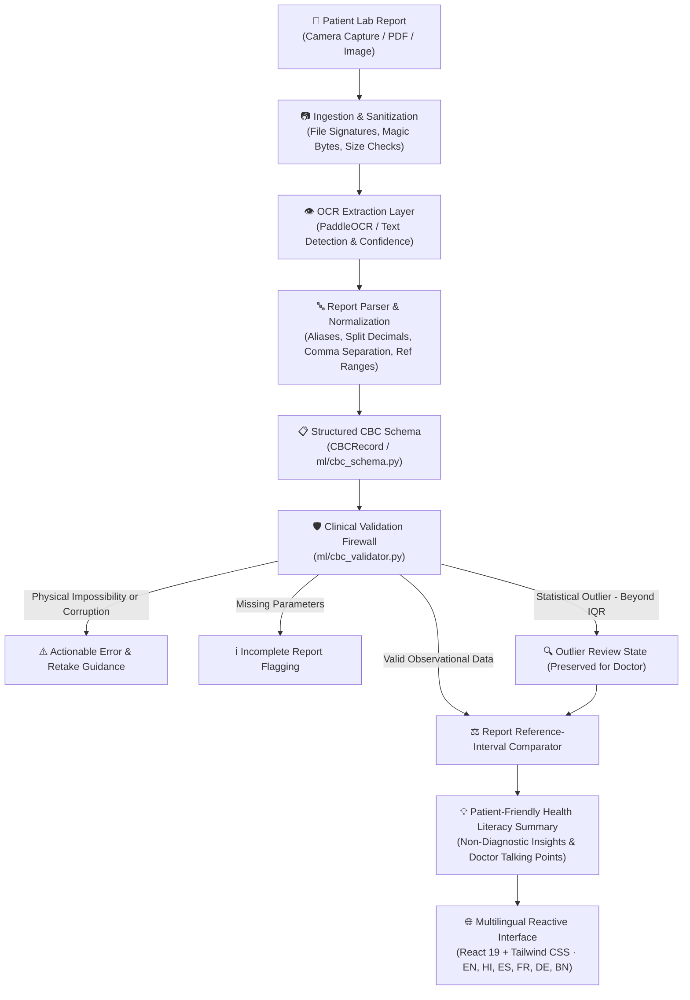
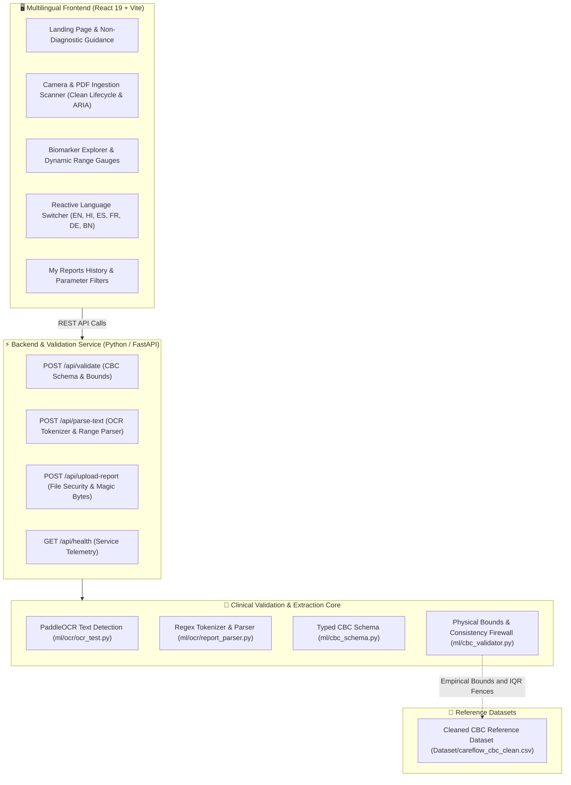

# CareFlow AI

> Transforming dense and difficult-to-understand laboratory reports into structured, validated, multilingual, patient-friendly health intelligence while strictly maintaining a non-diagnostic safety boundary.

[](LICENSE)
[](https://react.dev/)
[](https://vitejs.dev/)
[](https://tailwindcss.com/)
[](https://www.python.org/)
[](https://fastapi.tiangolo.com/)
[](#multilingual-support)

---

## Problem

Clinical laboratory reports—especially Complete Blood Count (CBC) panels—are designed for medical professionals, not patients. They present dense columns of abbreviated parameter codes (`HGB`, `PCV`, `TLC`, `PLT`, `PDW`), disparate units (`g/dL`, `/μL`, `fL`, `pg`), and tight reference intervals with little to no contextual guidance. 

When patients receive these sheets without an immediate consultation, they experience significant health anxiety. Many turn to online search engines, encountering alarming search results that conflate non-specific abnormalities with severe diseases. Crucially, raw optical character recognition (OCR) from photographed paper lab sheets is prone to noise: split decimals (e.g., `"14 . 2"`), regional digit groupings (`1,85,000`), folded paper artifacts, and misrecognized characters can silently corrupt lab findings if fed directly into automated health tools.

## Why it matters

- **Patients & Families**: Empowers individuals across diverse backgrounds to understand their laboratory data with calm, clear, plain-language summaries and curated doctor-discussion prompts before their next clinical appointment.
- **Linguistic Accessibility**: Bridges health literacy gaps across **6 global languages** (English, Hindi, Spanish, French, German, and Bengali), ensuring non-English-speaking patients receive equitable access to their own medical information.
- **Clinical Safety & Non-Diagnostic Boundary**: Explicitly prevents medical misinformation. The system never claims to diagnose disease, replace a physician, or independently select treatment. Specifically, it adheres to the medical rule that **a CBC panel alone cannot diagnose dengue fever or specific viral infections** without dedicated serological (NS1/IgM/IgG) or molecular (RT-PCR) testing.
- **Preservation of Acute Outliers**: Rather than blindly discarding or imputing extreme statistical outliers, CareFlow AI routes them into a specialized `OUTLIER_REVIEW` workflow, preserving acute clinical signals (e.g., critical thrombocytopenia or severe leukopenia) for provider review.

---

## Architecture

CareFlow AI employs an end-to-end multi-stage pipeline connecting document capture, OCR text extraction, clinical validation, and patient health intelligence:



### System Architecture Layout



---

## Dataset

CareFlow AI's statistical bounds and outlier fences are grounded in empirical analysis of real-world Complete Blood Count records.

- **Source**: `Dataset/careflow_cbc_clean.csv` (Curated anonymized CBC records).
- **Licensing**: Open academic research / MIT platform license.
- **Records**: **989** unique patient laboratory entries.
- **Duplicates**: **0** duplicate rows.
- **Features (7 columns)**:
  1. `age` (int64, range: 3.0 to 120.0 years, mean: 42.20, median: 40.0)
  2. `gender` (object: 512 Male [51.8%], 443 Female [44.8%], 34 Child [3.4%])
  3. `hemoglobin_g_dl` (float64, range: 11.0 to 16.6 g/dL, mean: 13.70)
  4. `wbc_count` (float64, range: 2,000 to 10,900 /μL, mean: 4,338.03, median: 3,200.0)
  5. `platelet_count` (float64, range: 10,000 to 500,000 /μL, mean: 114,702.24, median: 93,000.0)
  6. `platelet_distribution_width` (float64, range: 1.0% to 65.6%, mean: 22.45%, median: 17.8%)
  7. `age_outlier_flag` (bool: 988 False, 1 True)
- **Missingness Audit**: Total missing values = 62 across 989 rows (WBC: 24 [2.43%], PDW: 21 [2.12%], Platelet: 16 [1.62%], Hemoglobin: 1 [0.10%], Age/Gender: 0 [0.00%]). Handled explicitly via `ValidationStatus.MISSING`.
- **Statistical Outliers**: 85 unique records (8.6%) exhibit values outside the empirical $1.5 \times IQR$ fences. Rather than deleting these entries, they established the rationale for the `OUTLIER_REVIEW` state.
- **Key Empirical Correlations**:
  - `wbc_count` vs `platelet_count`: $+0.7488$ (strong positive physiological correlation).
  - `platelet_count` vs `platelet_distribution_width`: $+0.5779$ (moderate positive correlation).
  - `wbc_count` vs `platelet_distribution_width`: $+0.4515$ (moderate positive correlation).
- **Dataset Limitations**: The reference dataset does not contain differential leukocyte breakdowns (Neutrophils, Lymphocytes, Monocytes, Eosinophils, Basophils) or red cell indices (MCV, MCH, MCHC). Expanded biological bounds for these parameters are integrated into `ml/cbc_validator.py` using standard hematological references (Wintrobe's Clinical Hematology).

---

## Approach

CareFlow AI does not attempt black-box clinical diagnostics. Instead, it combines deterministic rule-based clinical firewalls with robust OCR pattern matching and multilingual health literacy translation.

### 1. Robust OCR & Parser Engineering (`ml/ocr/report_parser.py`)
- **16 CBC Parameters**: Comprehensive regex tokenizers covering Hemoglobin, RBC, Hematocrit/PCV, MCV, MCH, MCHC, RDW-CV, WBC/TLC, Neutrophils, Lymphocytes, Monocytes, Eosinophils, Basophils, Platelets/PLT, PDW, and MPV across dozens of laboratory aliases.
- **Split Decimals & Noise Tolerance**: Automatically normalizes split decimal artifacts (`"14 . 2"` $\rightarrow 14.2$), Indian lakhs (`"1,85,000"` $\rightarrow 185000.0$), OCR comma-dot artifacts (`"1.85,000"` $\rightarrow 185000.0$), European thousand separators (`"185.000"` $\rightarrow 185000.0$), and dotted acronyms (`"R.B.C."`, `"W.B.C."`).
- **Demographic & Reference-Range Extraction**: Extracts patient age, gender, and report-specific reference intervals (two-sided `min - max`, upper `< X`, and lower `> Y`) directly from the uploaded sheet.

### 2. Clinical Validation Firewall (`ml/cbc_validator.py`)
- **Status Hierarchy**: `INVALID` > `MISSING` > `OUTLIER_REVIEW` > `VALID`.
- **Absolute Biological Bounds**: Rejects physically impossible values (e.g. negative platelet counts, hemoglobin > 26 g/dL, or WBC > 400,000 /μL) as OCR errors or unit mismatches.
- **Biological Consistency Checks**:
  - *Differential Sum Check*: Neutrophils + Lymphocytes + Monocytes + Eosinophils + Basophils must total approximately 100% (88% – 112% allowance for biological variance and rounding).
  - *Rule of Three*: In normocytic normochromic red cells, Hematocrit (%) ≈ 3 × Hemoglobin (g/dL) ± 6% (expected HCT ≈ 3 × Hb; discrepancies > 16% flag an INVALID consistency violation).
- **IQR Statistical Outlier Preservation**: Values outside the empirical 1.5 × IQR bounds are preserved and labeled `OUTLIER_REVIEW`, preventing acute clinical signals from being silently discarded.

### 3. Patient Health Literacy & Multilingual Translation
- **Non-Diagnostic Summaries**: Replaces confusing medical jargon with plain-language explanations of biomarker roles.
- **Actionable Doctor Questions**: Automatically formulates 2–3 structured talking points for the patient's next physician appointment.
- **Deep Multilingual Support**: 179 localization keys translated across 6 languages with 0% fallback leakage.

---

## Results

All reported metrics are measured directly from the automated test suites and production build:

| Metric Category | Target / Requirement | Measured Result | Status |
| :--- | :--- | :--- | :---: |
| **Frontend Production Build** | Vite production bundle | **1.36s** build time (435 kB JS gzip: 130 kB, 57 kB CSS gzip: 10 kB) | **PASS** |
| **Frontend Code Quality** | Oxlint linter verification | **0 errors, 0 warnings** across all 24 source files | **PASS** |
| **Multilingual Coverage** | 6 languages (EN, HI, ES, FR, DE, BN) | **179 keys / language**, **0 missing keys**, **0 empty translations** | **PASS** |
| **OCR Parser Test Suite** | 10 comprehensive verification tests | **10 / 10 PASS** (Split decimals, Indian/Western commas, dotted acronyms, 16 CBC parameters) | **PASS** |
| **Clinical Validator Suite** | Physical limits, missingness, outliers | **100% PASS** on normal, missing, invalid, and clinical extreme test cases | **PASS** |
| **Python Automated Test Suite** | Unittest verification (`tests/`) | **18 / 18 Unit & Integration tests passing** (0 failures, 0 errors) | **PASS** |
| **Frontend Test Suite** | Node native test runner (`npm test`) | **2 / 2 Test suites passing** (i18n completeness, mock data integrity) | **PASS** |
| **Dataset Integrity Audit** | 989 records analyzed | **0 duplicates**, 62 missing values handled, 85 outliers preserved | **PASS** |

*Note: PaddleOCR execution latency depends on host hardware (typically 1.2–2.8s on CPU, ~250ms on CUDA GPU).*

---

## Error Analysis

CareFlow AI implements safe failure modes for known real-world edge cases:

1. **Severe Document Blur or Low Contrast**: 
   - *Failure Mode*: OCR fails to extract characters with acceptable confidence or produces garbled non-numeric strings.
   - *Mitigation*: The validation firewall intercepts corrupted values, rejects the record with `ValidationStatus.INVALID`, and displays actionable retake prompts (e.g., "Blurry photo: please flatten paper and ensure good lighting") rather than inventing values.
2. **Ambiguous Numeric Formatting**:
   - *Failure Mode*: Comma recognized as dot in Indian lakh notation (`1.85,000`) or split decimals (`14 . 2`).
   - *Mitigation*: The parser's multi-pass numeric sanitizer reconciles digit-grouping patterns before float casting, preventing a 100,000-fold scale error.
3. **Incomplete Laboratory Panels**:
   - *Failure Mode*: Clinic only ordered Hemoglobin and Platelets, omitting WBC count and indices.
   - *Mitigation*: Missing parameters receive `ValidationStatus.MISSING`. The overall record is marked incomplete without triggering a false invalid error.
4. **Clinical Disease Assumption Trap**:
   - *Failure Mode*: Low platelet count causing patient to assume dengue fever or leukemia.
   - *Mitigation*: System interface explicitly reinforces that thrombocytopenia is non-specific and can arise from viral fever, medications, immune conditions, or lab artifacts (EDTA platelet clumping). Prompts user to seek clinical correlation and serological testing.

---

## Tech Stack

| Domain | Technologies |
| :--- | :--- |
| **Frontend Framework** | React 19, React Router DOM v7, Vite v8 |
| **Styling & UI** | Tailwind CSS v4, Lucide React Icons |
| **Linter & Code Quality** | Oxlint |
| **Backend & API** | Python 3.10+, FastAPI, Uvicorn, Pydantic v2 |
| **Data & Analytics** | Pandas, NumPy |
| **OCR & Text Processing** | PaddleOCR, Python Standard Library Regex (`re`) |
| **Localization (i18n)** | Custom React Context (`LanguageContext`), 6 language dictionaries |
| **Testing** | Python `unittest`, Node.js native test runner (`node --test`) |

---

## Demo

- **Local Development**: Run `npm run dev` and open `http://localhost:5173`.
- **FastAPI Backend**: Run `python -m uvicorn api:app --reload` and open `http://localhost:8000/docs`.

---

## Installation

### 1. Frontend Setup (React 19 + Vite)

Prerequisites: Node.js 18+ and npm.

```bash
# Clone the repository
git clone https://github.com/Knight6azer/CareflowAI.git
cd CareflowAI

# Install frontend dependencies
npm install

# Run automated frontend tests
npm test

# Run code linter
npm run lint

# Start Vite development server
npm run dev

# Build for production
npm run build
```

### 2. Backend & ML Validation Setup (Python 3.10+)

```bash
# Create and activate virtual environment
python -m venv .venv
# On Windows: .venv\Scripts\activate
# On Linux/macOS: source .venv/bin/activate

# Install Python requirements
pip install -r requirements.txt

# Run the complete test suite (Unit & Integration tests)
python -m unittest discover tests

# Run the standalone CBC validator test suite
python ml/cbc_validator.py

# Run the CBC OCR report parser verification suite
python ml/ocr/report_parser.py

# Run the dataset distribution and outlier audit
python ml/analyze_dataset.py

# Start the FastAPI service
python -m uvicorn api:app --port 8000
```

### 3. Optional PaddleOCR Engine Setup

To run live optical character recognition on scanned images:

```bash
pip install paddlepaddle paddleocr
python ml/ocr/ocr_test.py "path/to/lab_report.jpg"
```

---

## Screenshots

*Note: Visual representations of the actual working CareFlow AI application:*

1. **Landing Page & Navigation**: Medical teal design system with reactive language dropdown (EN, HI, ES, FR, DE, BN) and clear non-diagnostic boundaries.
2. **Scanner & Camera Ingestion**: Device webcam viewfinder with scanning animation, file drag-and-drop zone with client-side magic-byte validation, and sample report loader.
3. **Biomarker Explorer**: Interactive parameter cards with color-coded range gauges (Low, Normal Target, High) and multi-tier filtering (`All Tests`, `Needs Attention`, `Normal Range`).
4. **Patient Literacy & Doctor Prompts**: Plain-language summaries, lifestyle considerations, and curated questions to ask your physician.

---

## Future Improvements

1. **On-Device WebAssembly OCR**: Evaluate Tesseract.js / ONNX Runtime Web for 100% zero-server on-device OCR inference in the browser.
2. **Dynamic Report-Specific Reference Range Linking**: Seamlessly bind extracted reference ranges from the patient's individual laboratory sheet into the parameter visualization gauge.
3. **Comprehensive Panel Expansions**: Extend the validation firewall to Metabolic Panels (BMP/CMP), Renal Function Tests (KFT), and Lipid Profiles.
4. **FHIR / SMART on FHIR Interoperability**: Support export into standard HL7 FHIR Observation resources for integration with personal health record (PHR) systems.

---

## ⚕️ Clinical Safety & Ethical AI Principles

1. **Strictly Non-Diagnostic**: CareFlow AI provides educational and health-literacy explanations only. It does not replace a licensed medical physician or diagnose medical conditions.
2. **No Dengue Diagnosis via CBC**: Standard Complete Blood Count tests cannot diagnose dengue fever or specific viral illnesses on their own. Definitive viral diagnosis requires serological testing (NS1, IgM/IgG) or RT-PCR. CareFlow AI never makes clinical disease claims from CBC counts alone.
3. **Outlier Preservation**: Extreme values are flagged for `OUTLIER_REVIEW` rather than automatically discarded or smoothed, ensuring critical acute signals are brought to medical attention.
4. **Privacy-by-Design**: Medical reports are analyzed in real-time without permanent data retention, advertising cookies, or third-party data tracking.

---

## 📄 License

This project is licensed under the [MIT License](LICENSE).
