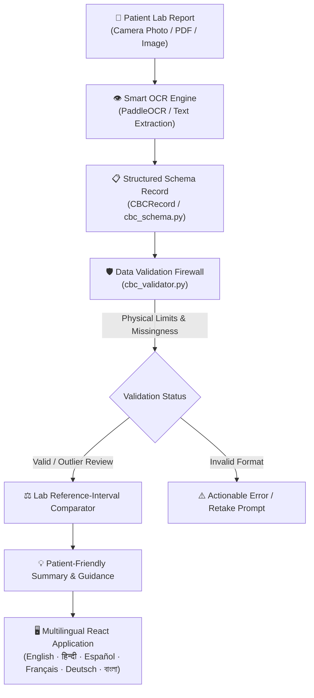

# CareFlow AI — Multilingual Patient Health Intelligence Platform

[](LICENSE)
[](https://react.dev/)
[](https://tailwindcss.com/)
[](https://www.python.org/)
[](#multilingual-support)

**CareFlow AI** is a modern, patient-first healthcare intelligence platform designed to eliminate the anxiety and confusion of reading medical laboratory reports. By combining Optical Character Recognition (OCR), a strict clinical data validation firewall, and multilingual health literacy translation, CareFlow AI converts dense laboratory sheets into clear, empathetic, and actionable explanations.

---

## 🌟 Key Capabilities

- 🌐 **One-Go Multilingual Interface**: Full, seamless localization across **6 global languages** (English, Hindi, Spanish, French, German, and Bengali).
- 📷 **Universal Ingestion**: Capture paper reports using live smartphone/webcam guidance with automated edge alignment, or drag-and-drop PDF/image documents.
- 🔬 **Optical Character Recognition (OCR)**: Robust parsing that extracts test parameters, numerical findings, units, and laboratory-printed reference intervals while tolerating split decimals (`"14 . 2"` $\rightarrow 14.2$), Indian & Western comma separators (`1,85,000`), and dotted acronyms (`R.B.C.`, `W.B.C.`).
- 🛡️ **Clinical Validation Firewall**: Non-diagnostic validation rules (`ml/cbc_validator.py`) verifying physical limits, numeric integrity, and missingness before downstream interpretation.
- 📊 **Preservation of Clinical Outliers**: Rather than deleting or imputing statistical outliers, abnormal results are flagged for `OUTLIER_REVIEW`, preserving acute clinical signals for physicians.
- 💬 **Patient-Centric Health Literacy**: Replaces intimidating medical jargon with plain-language explanations, lifestyle/diet considerations, and curated talking points for your doctor.

---

## 🏗️ Architecture Pipeline



---

## 🌍 Multilingual Support

CareFlow AI features an integrated real-time language switcher that dynamically re-renders the complete interface, navigation, status badges, parameter descriptions, and clinical guidance:

| Code | Language | Native Name | Flag |
| :---: | :--- | :--- | :---: |
| `en` | **English** | English | 🇺🇸 |
| `hi` | **Hindi** | हिन्दी | 🇮🇳 |
| `es` | **Spanish** | Español | 🇪🇸 |
| `fr` | **French** | Français | 🇫🇷 |
| `de` | **German** | Deutsch | 🇩🇪 |
| `bn` | **Bengali** | বাংলা | 🇧🇩 |

---

## 📂 Project Structure

```
CareflowAI/
├── .gitignore               # Unified Git exclusions (node_modules, dist, logs, venvs)
├── LICENSE                  # MIT License
├── README.md                # Platform documentation & architecture guide
├── index.html               # Frontend HTML5 entry point with responsive viewport
├── package.json             # NPM dependencies & scripts (React 19, Tailwind CSS v4, Lucide)
├── vite.config.js           # Vite build and bundling configuration
├── Dataset/
│   └── careflow_cbc_clean.csv # Cleaned CBC reference dataset for statistical audits
├── ml/                      # Machine Learning, Validation, & OCR Processing Layer
│   ├── analyze_dataset.py   # Dataset distribution & IQR outlier auditing script
│   ├── cbc_schema.py        # Typed data models & validation enumerations
│   ├── cbc_validator.py     # Biological bounds, missingness, & statistical validator
│   ├── README.md            # Comprehensive documentation for the ML & validation layer
│   └── ocr/
│       ├── ocr_test.py      # PaddleOCR text detection & recognition runner
│       ├── report_parser.py # Regex tokenization & reference range extraction
│       └── README.md        # OCR prototype installation and usage documentation
├── public/                  # Public assets (icons, SVGs, favicon)
└── src/                     # React 19 Application
    ├── main.jsx             # React DOM entry point
    ├── App.jsx              # Main router & root LanguageProvider wrapper
    ├── App.css / index.css  # Tailwind styling & medical theme glassmorphism
    ├── context/
    │   └── LanguageContext.jsx # Reactive i18n Context and language state
    ├── i18n/
    │   ├── languages.js     # Supported language definitions & flags
    │   └── translations.js  # High-fidelity multilingual translation dictionaries
    ├── components/          # Reusable UI component library
    │   ├── Button.jsx       # Standardized primary/secondary button
    │   ├── CameraScanner.jsx# Interactive camera scanner with viewfinder & laser overlay
    │   ├── Card.jsx         # Glassmorphic card container with hover glow
    │   ├── Disclaimer.jsx   # Clinical safety disclaimer banner
    │   ├── Footer.jsx       # Multilingual footer with quick links & privacy badges
    │   ├── Modal.jsx        # Accessible modal dialog
    │   ├── Navbar.jsx       # Sticky navigation bar with integrated language switcher
    │   ├── ParameterCard.jsx# Interactive biomarker card with visual gauge indicator
    │   ├── ProgressIndicator.jsx # Step-by-step OCR & validation progress visualizer
    │   ├── ReportCard.jsx   # Report overview card with status pills
    │   ├── StatusBadge.jsx  # Localized status pills (Normal, Low, High, Outlier Review)
    │   └── UploadArea.jsx   # Drag-and-drop document upload zone
    ├── data/
    │   └── mockData.js      # Structured laboratory datasets & biomarker details
    └── pages/
        ├── Home.jsx         # Platform landing page with hero preview & workflow
        ├── ScanReport.jsx   # Ingestion page with camera scanning & file upload
        ├── MyReports.jsx    # Report history explorer with search, filters, & sorting
        ├── ReportDetails.jsx# Deep-dive report view with parameter filters & doctor prompts
        └── About.jsx        # Mission, architecture pillars, and ethical AI guidelines
```

---

## 🚀 Quick Start Guide

### 1. Web Application (Frontend)

Prerequisites: Node.js 18+ and npm.

```bash
# Clone the repository
git clone https://github.com/Knight6azer/CareflowAI.git
cd CareflowAI

# Install dependencies
npm install

# Start development server
npm run dev
```

To create an optimized production build:
```bash
npm run build
npm run preview
```

### 2. Python ML & Validation Pipeline

Prerequisites: Python 3.10+.

```bash
# Optional virtual environment
python -m venv .venv
# On Windows: .venv\Scripts\activate
# On Linux/macOS: source .venv/bin/activate

# Install requirements
pip install -r requirements.txt

# Run the CBC Validation Engine and built-in unit tests
python ml/cbc_validator.py

# Run the CBC Report OCR Parser test suite
python ml/ocr/report_parser.py

# Run the dataset distribution audit
python ml/analyze_dataset.py
```

---

## ⚕️ Clinical Safety & Ethical AI Principles

1. **Strictly Non-Diagnostic**: CareFlow AI provides educational and health-literacy explanations only. It does not replace a licensed medical physician or diagnose medical conditions.
2. **No Dengue Diagnosis via CBC**: Standard Complete Blood Count tests cannot diagnose dengue fever or specific viral illnesses on their own. Definitive viral diagnosis requires serological testing (NS1, IgM/IgG) or RT-PCR. CareFlow AI never makes clinical disease claims from CBC counts alone.
3. **Outlier Preservation**: Extreme values are flagged for `OUTLIER_REVIEW` rather than automatically discarded or smoothed, ensuring critical acute signals are brought to medical attention.
4. **Privacy-by-Design**: Medical reports are analyzed in real-time without permanent data retention or third-party tracking.

---

## 📄 License

This project is licensed under the [MIT License](LICENSE).
