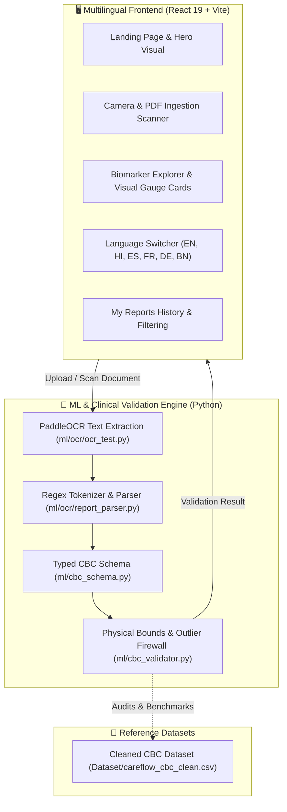

# CareFlow AI — Architectural Implementation & Integration Guide

CareFlow AI is an end-to-end healthcare intelligence platform featuring a **modern React 19 + Tailwind CSS** multilingual frontend, integrated **Optical Character Recognition (OCR)** ingestion, a **strict clinical CBC validation firewall** (`ml/cbc_validator.py`), and a non-diagnostic patient health literacy engine.

---

## 🏛️ System Architecture



---

## 🎨 Design Language & Aesthetic

| Attribute | Specification |
|:---|:---|
| **Primary Theme** | Clean Medical Teal (`#0D9488` / `#0F766E`) with Slate/Cyan Neutrals |
| **Warning / Attention** | Amber Alert (`#D97706` / `#78350F`) |
| **Normal / Safe** | Emerald Health (`#059669` / `#065F46`) |
| **Critical / Outlier** | Rose Review (`#E11D48`) |
| **Typography** | Plus Jakarta Sans (Headings), Inter (Body) |
| **Aesthetic** | Clinical clarity, glassmorphism, responsive viewfinders, high accessibility |

---

## 📋 Completed Implementation Phases

### Phase 1: Clean Git Foundation & Dependency Configuration
- Unified `.gitignore` across JavaScript, Vite, Python, and OS artifacts.
- Production configuration in `package.json` with React 19, Tailwind CSS v4, Lucide icons, and Oxlint.

### Phase 2: Typed Clinical Data Models & Bounds
- Implemented `ml/cbc_schema.py` defining `CBCRecord`, `FieldValidationResult`, and `CBCValidationResult`.
- Defined physiological upper and lower bounds for 16 primary Complete Blood Count markers.

### Phase 3: Validation Firewall & Outlier Preservation
- Implemented `ml/cbc_validator.py` with numeric integrity checks, physical limits, and statistical IQR outlier detection.
- Enforced ethical medical guidelines: acute outliers are tagged `OUTLIER_REVIEW` for doctor review rather than deleted.

### Phase 4: OCR Engine & Report Parser Prototype
- Implemented `ml/ocr/ocr_test.py` with PaddleOCR detection and confidence scoring.
- Implemented `ml/ocr/report_parser.py` extracting lab aliases, split decimals, comma formats, and reference intervals.

### Phase 5: Reactive Multilingual System (i18n)
- Implemented `src/context/LanguageContext.jsx` with persistent locale preferences.
- Authored full translation dictionaries (`src/i18n/translations.js`) covering English, Hindi, Spanish, French, German, and Bengali.
- Integrated sticky language dropdown in `src/components/Navbar.jsx`.

### Phase 6: Interactive Camera Scanner & File Ingestion
- Implemented `src/components/CameraScanner.jsx` with real device webcam streaming, orientation switching, scanning laser beam animation, and mock document fallback.
- Implemented `src/components/UploadArea.jsx` with drag-and-drop validation and 256-bit encryption indicators.
- Added one-click sample report generator in `src/pages/ScanReport.jsx`.

### Phase 7: Biomarker Explorer & Visual Gauges
- Implemented `src/components/ParameterCard.jsx` featuring dynamic percentage markers and color-coded range zones (Low, Normal Target, High).
- Added multi-tier parameter filtering (`All Tests`, `Needs Attention`, `Normal Range`) in `src/pages/ReportDetails.jsx`.

### Phase 8: Clinical Safety & Patient Empowerment
- Implemented non-diagnostic disclaimers (`src/components/Disclaimer.jsx`).
- Formulated clear doctor-discussion prompts and practical lifestyle considerations on every analyzed report.

---

## 🧪 Verification & Testing Commands

```bash
# 1. Verify frontend build
npm run build

# 2. Run CBC Validator unit tests
python ml/cbc_validator.py

# 3. Run OCR Parser test suite
python ml/ocr/report_parser.py

# 4. Run Dataset Audit
python ml/analyze_dataset.py
```
