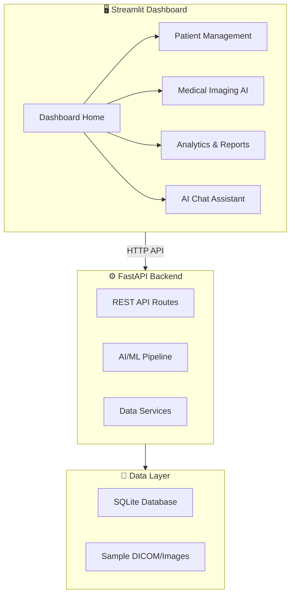

# CareFlow AI — End-to-End Healthcare Python Application

Build a premium, healthcare-oriented Python application featuring a **Streamlit dashboard** frontend with a **FastAPI** backend, dark-themed medical UI, and modular AI pipeline architecture.

## Architecture Overview



## Design Language

| Attribute | Value |
|:---|:---|
| **Primary Color** | `#00D4AA` (Medical Teal/Cyan) |
| **Accent** | `#7C5CFC` (Soft Violet) |
| **Background** | `#0A0E1A` → `#111827` (Deep Space Dark) |
| **Cards** | `#1A1F2E` with subtle `rgba(0,212,170,0.08)` glow borders |
| **Font** | Inter (headings), IBM Plex Sans (body) |
| **Aesthetic** | Glassmorphism + subtle neon accents, medical iconography |

---

## 12-Phase Implementation Plan

We will implement this project in 12 distinct, detail-oriented phases:

### Phase 1: Project Setup & Core Configuration
- Create all project directories (`backend/`, `pages/`, `components/`, `utils/`, `data/`, `assets/`, `.streamlit/`).
- Create `requirements.txt` with all necessary dependencies.
- Create `.streamlit/config.toml` to define the baseline dark theme and font settings.

### Phase 2: Database Schema & Data Models
- Define Pydantic models in `backend/models.py`.
- Create SQLite initialization and connection logic in `utils/database.py`.

### Phase 3: Synthetic Data Generation
- Develop `utils/sample_data.py` to generate realistic synthetic patients, vitals, and scan histories to populate the database.

### Phase 4: Backend API Core
- Set up the FastAPI server in `backend/api.py`.
- Implement health checks and basic CORS configuration.

### Phase 5: Theming & Core UI Components
- Develop `utils/theme.py` to inject custom CSS (glassmorphism, medical aesthetics).
- Create `components/sidebar.py` for custom navigation and branding.

### Phase 6: Dashboard Home Page
- Build `app.py`, the main entry point.
- Implement the `components/metrics.py` for KPI cards and layout the overview dashboard.

### Phase 7: Patient Management (Backend + Frontend)
- Implement backend CRUD operations for patients in `backend/services.py` and API routes.
- Build `pages/1_🏥_Patient_Management.py` with data tables and detail views.

### Phase 8: Medical Imaging AI Interface
- Build `pages/2_🧠_Medical_Imaging.py` with drag-and-drop upload.
- Implement mocked AI inference endpoints in the backend for processing X-Rays/Scans.

### Phase 9: Analytics & Reporting Data
- Implement data aggregation routes in the FastAPI backend.
- Build `components/charts.py` for themed Plotly charts.

### Phase 10: Analytics Dashboard
- Build `pages/3_📊_Analytics.py` to render the interactive Plotly charts and exportable reports.

### Phase 11: AI Assistant Chatbot
- Implement a chat API route in the backend with simulated clinical reasoning.
- Build `pages/4_🤖_AI_Assistant.py` for the conversational UI.

### Phase 12: Final Integration & Polish
- Connect all frontend components seamlessly with the FastAPI backend.
- Run end-to-end tests, refine animations, fix edge cases, and finalize documentation.

---

> [!IMPORTANT]
> **This is a draft/demo application.** All AI inference is simulated with realistic mock data and delays. No real ML models are bundled — the architecture is designed so real models (PyTorch, TensorFlow, ONNX) can be plugged into `backend/services.py` later.

## Verification Plan

### Automated Tests
```bash
# Install dependencies
pip install -r requirements.txt

# Launch the Streamlit app
streamlit run app.py

# Launch the FastAPI backend (separate terminal)
uvicorn backend.api:app --reload --port 8000
```

### Manual Verification
- Verify Streamlit dashboard loads with premium dark healthcare theme
- Navigate all 4 pages and confirm data renders
- Test patient search/filter functionality
- Upload a test image on the Medical Imaging page
- Verify charts render with correct theming on Analytics page
- Test the AI Assistant chat interface
- Confirm FastAPI docs accessible at `http://localhost:8000/docs`
